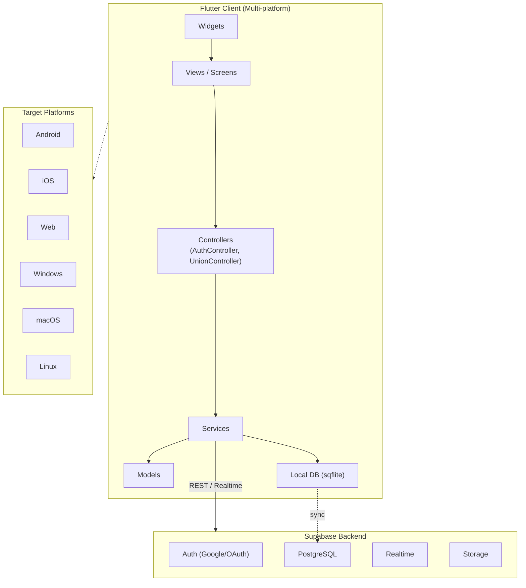

# TransitFlow SL

A Flutter application for **commercial motorcycle union management and financial compliance**, built for Sierra Leone (Freetown). TransitFlow SL digitises rider registration, bike/plate management, station zones, daily fee collection, safety inspections, compliance disputes, announcements, and executive analytics for motorcycle union operations.

## System Architecture



### Layers

- **Presentation**: `views/`, `widgets/` – screens and reusable UI components.
- **State**: `controllers/` – `ChangeNotifier` providers (Auth, Union).
- **Domain**: `models/` – typed entities (Rider, Bike, DailyLog, ...).
- **Data/Services**: `services/` – business logic and Supabase/local DB access.
- **Persistence**: `database/local_database.dart` (sqflite) + Supabase PostgreSQL.
- **Config**: `config/` – AppConfig, AppTheme.

- **Authentication & Roles** – Google sign-in, credential login, demo role switching (rider, inspector, executive, admin), offline-resilient demo mode.
- **Rider & Bike Management** – Registration, profile, ledger, linked plate numbers, inspection status.
- **Station Zones** – Zone-based station permits and geographic organisation of riders/bikes.
- **Financial Compliance** – Fee types, daily logs, payment gateway, receipts, rider ledger.
- **Safety Inspections** – Inspection records and status tracking.
- **Governance** – Compliance disputes, union announcements, notifications, audit trail logs.
- **Executive Analytics** – Dashboards for union leadership.
- **Offline Resilience** – Local SQLite database (`sqflite`) with seed data and sync to Supabase.

## Tech Stack

- **Framework**: Flutter (Dart SDK `^3.13.4`)
- **State Management**: `provider`
- **Backend**: Supabase (`supabase_flutter`)
- **Local DB**: `sqflite` (via `local_database.dart`)
- **Utilities**: `intl`, `crypto`, `uuid`, `shared_preferences`, `cupertino_icons`
- **Linting**: `flutter_lints`

## Project Structure

```
lib/
├── main.dart                 # App entry, routing, MultiProvider setup
├── config/                   # AppConfig (Supabase, currency, SDG targets), AppTheme
├── controllers/              # AuthController, UnionController (ChangeNotifier)
├── database/                 # LocalDatabase, seed data
├── models/                   # Domain models (Rider, Bike, DailyLog, FeeType, ...)
├── services/                 # AuthService, RiderService, PaymentService, ...
├── views/                    # Screens (splash, onboarding, auth, home, dashboards, ...)
└── widgets/                  # Reusable UI components
supabase/
├── migrations/               # SQL schema migrations
└── seed.sql                  # Seed data
test/                        # Widget tests
```

## Getting Started

### Prerequisites

- Flutter SDK (Dart `^3.13.4`)
- Supabase project (optional; app runs in demo/offline mode by default)

### Install dependencies

```bash
flutter pub get
```

### Run

```bash
flutter run
```

### Configure Supabase (optional)

Pass credentials via `--dart-define`:

```bash
flutter run \
  --dart-define=SUPABASE_URL=https://your-project.supabase.co \
  --dart-define=SUPABASE_ANON_KEY=your-anon-key
```

Or configure at runtime from the in-app settings screen.

### Build

```bash
flutter build apk        # Android
flutter build ios        # iOS
flutter build web        # Web
flutter build windows    # Windows
```

## Database

Supabase schema lives in `supabase/migrations/20261124000000_transitflow_schema.sql` with seed data in `supabase/seed.sql`. Apply migrations with the Supabase CLI:

```bash
supabase db push
```

## Testing

```bash
flutter test
```

## SDG Alignment

- **SDG 11** – Sustainable Cities & Communities (Target 11.2: safe, affordable, accessible, sustainable transport)
- **SDG 8** – Decent Work & Economic Growth

## License

Private project (`publish_to: 'none'`). All rights reserved.
# SE_GROUP_PROJECT_TRANSITFLOW
